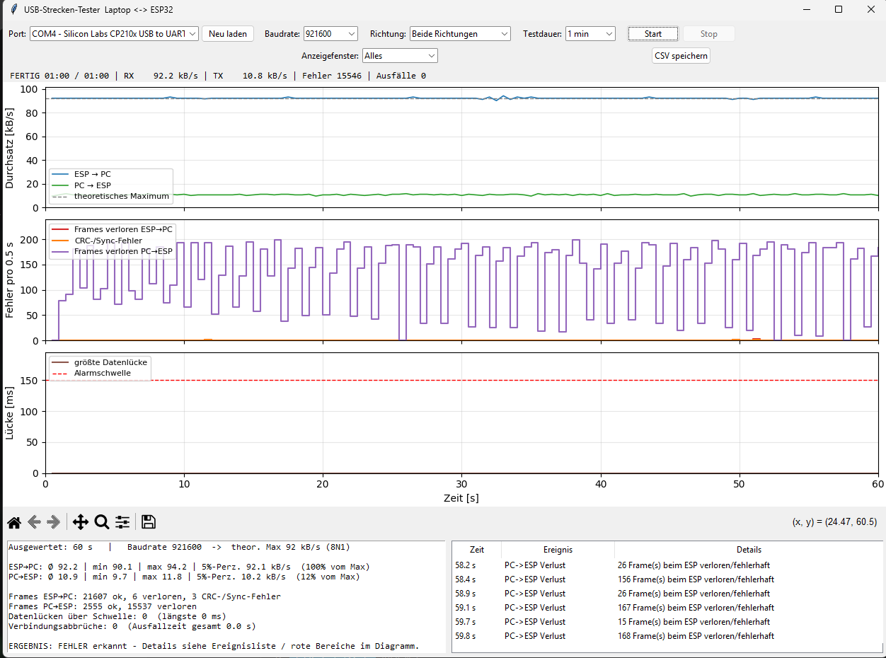

# 🔌 USB Link Tester

**USB-UART link tester for ESP32 — measures maximum throughput and logs dropouts with live charts**

[](https://www.python.org/)
[](https://www.arduino.cc/)
[](https://www.espressif.com/)
[](https://matplotlib.org/)
[](https://www.microsoft.com/windows)

---

## About

A small test bench for the connection between a laptop and an ESP32: **cable → USB port → USB-UART bridge (e.g. CP210x) → ESP32**. The ESP32 and a Python desktop app exchange CRC-protected frames at full line speed in both directions. Every lost frame, corrupted frame, data gap, reconnect and ESP reset is counted, timestamped and drawn in live charts — useful for finding bad cables, flaky ports or the real maximum baud rate of your USB-UART chip.



## Features

- **Maximum Throughput Test** — streams 256-byte frames at full line speed (up to 3 Mbaud)
- **Bidirectional** — test ESP → PC, PC → ESP or both at once
- **Live Charts** — throughput vs. theoretical maximum, errors per 0.5 s, largest data gap
- **Dropout Detection** — lost frames (sequence gaps), CRC/sync errors, data gaps, connection loss, ESP resets
- **Auto Reconnect** — cable unplugged? Outage is marked red in the charts and the test continues
- **Selectable Duration** — 30 s, 1, 5, 10, 30, 60 min or endless
- **Selectable Chart Window** — all, last 1 / 5 / 10 / 30 min (also after the test)
- **Automatic Baud Negotiation** — no reflashing needed to change speed
- **Evaluation** — average, min, max, 5th percentile, loss counters, OK/FAIL verdict
- **CSV Export** — measurement data and event log

## Tech Stack

| Layer           | Technology                                      |
| --------------- | ----------------------------------------------- |
| Firmware        | C++ (Arduino Framework)                         |
| Microcontroller | ESP32-WROOM (UART0 via USB-UART bridge)         |
| Desktop App     | Python 3.10, Tkinter                            |
| Serial          | pyserial                                        |
| Charts          | Matplotlib (embedded), NumPy                    |
| Integrity       | CRC-16/CCITT-FALSE, sequence numbers            |

## System Overview

```
 ┌──────────────┐   USB cable   ┌──────────────┐  UART   ┌──────────────┐
 │   Laptop     │◄─────────────►│  USB-UART    │◄───────►│    ESP32     │
 │   Python GUI │               │  bridge      │ 3.3 V   │    Sketch    │
 │ (usblink...) │               │  (CP210x)    │         │ (usbtester)  │
 └──────────────┘               └──────────────┘         └──────────────┘
        │                                                        │
        │  ── 256-byte frames, CRC16, seq ───────────────────►   │  PC → ESP
        │  ◄──────────────────── 256-byte frames, CRC16, seq ──  │  ESP → PC
        │                                                        │
        └─ counts: ok / lost / CRC errors / gaps / reconnects    └─ reports its own
                                                                    rx counters in
                                                                    every frame
```

> The tester measures the **whole chain** (cable, port, bridge chip, driver). The USB bus itself (12 Mbit/s full speed on most ESP32 boards) is not the limit — the **UART baud rate** is.

## Frame Format

Both directions use the same fixed 256-byte frame:

| Offset  | Size | Field                                                       |
| ------- | ---- | ----------------------------------------------------------- |
| 0       | 2    | Sync `0xAA 0x55`                                            |
| 2       | 4    | Sequence number (u32, little endian)                        |
| 6       | 4    | Frames the ESP32 received correctly from the PC (u32)       |
| 10      | 4    | Frames the ESP32 missed from the PC (u32)                   |
| 14      | 240  | Payload                                                     |
| 254     | 2    | CRC-16/CCITT-FALSE over bytes 2–253                         |

Loss in the ESP → PC direction is detected by the PC via sequence gaps. Loss in the PC → ESP direction is detected by the ESP and reported back in the counters above.

### Control Commands (text lines)

| Command    | Response  | Description                                           |
| ---------- | --------- | ----------------------------------------------------- |
| `P`        | `PONG`    | Ping                                                  |
| `B:<baud>` | `OK B`    | Switch baud rate (falls back to 115200 after 3 s idle) |
| `G:<mode>` | `OK G`    | Start test: `1` = ESP → PC, `2` = PC → ESP, `3` = both |
| `X`        | `OK X`    | Stop test                                             |
| `K`        | –         | Keepalive                                             |

## Getting Started

### Prerequisites

- Arduino IDE with ESP32 core (≥ 2.0.14 or 3.x)
- ESP32 board with USB-UART bridge (tested with CP210x)
- Python 3.10+

### Installation

```
# Clone the repository
git clone https://github.com/alexw611/usb-link-tester.git
cd usb-link-tester

# Install Python dependencies
python3 -m pip install -r requirements.txt
```

1. Open `usbtester/usbtester.ino` in Arduino IDE
2. Select board: **ESP32 Dev Module**, set **Core Debug Level: None**
3. Upload to ESP32
4. **Close the Arduino Serial Monitor** (the COM port is exclusive)

### Run a Test

```
python3 usblinktester.py
```

1. Select the COM port
2. Choose baud rate (start with `921600`, then try `1000000`, `2000000`, `3000000`)
3. Choose direction and test duration
4. Press **Start**

## Maximum Baud Rate by USB-UART Chip

| Chip              | Max. baud rate | ≈ Throughput (8N1) |
| ----------------- | -------------- | ------------------ |
| CP2102            | ~1 Mbaud       | ~100 kB/s          |
| CH340             | ~2 Mbaud       | ~200 kB/s          |
| CP2102N / FT232   | ~3 Mbaud       | ~300 kB/s          |

> If the handshake fails at a given baud rate, the bridge chip (or its driver) most likely does not support it — use the next lower value.

## Project Structure

```
usb-link-tester/
├── usblinktester.py        # Desktop app: GUI, test logic, charts, evaluation
├── usbtester/
│   └── usbtester.ino       # ESP32 firmware: frame generator / checker
├── images/
│   └── screenshot.png      # Example test run
├── requirements.txt        # pyserial, matplotlib, numpy
├── LICENSE                 # MIT License
└── README.md
```

## Known Limitations

- **Full-duplex loss (PC → ESP)** — In a 1-minute test at 921600 baud, ESP → PC ran at 100 % of the theoretical maximum (~92 kB/s), while PC → ESP reached only ~11 kB/s with many lost frames when both directions ran simultaneously. Under investigation (see Planned Features).
- **Baud rate** — limited by the USB-UART bridge chip, not by the USB port (USB 3.x gives no advantage).
- **Auto-reset** — opening the port can reset some ESP32 boards via DTR/RTS; the app sets both lines low to avoid this, but some boards still pulse them.
- **Platform** — developed and tested on Windows.

## Planned Features

- [ ] Fix PC → ESP frame loss in full-duplex mode
- [ ] Separate single-direction runs in the evaluation
- [ ] WiFi throughput test (TCP/UDP) for the ESP32 network link
- [ ] Support for ESP32-S3 / C3 native USB (CDC)
- [ ] Standalone `.exe` build
- [ ] PNG / PDF report export

## License

This project is licensed under the [MIT License](LICENSE).
